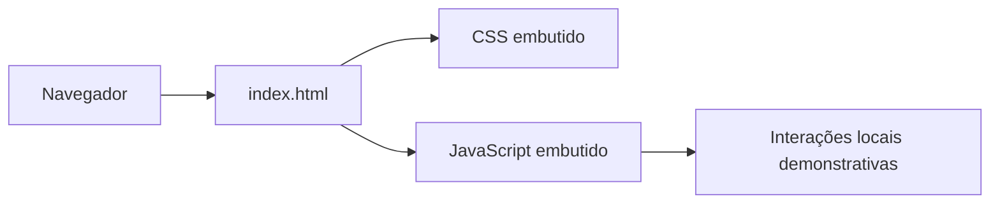

 |  | 

# Aurora Shop — Vitrine Estática

## Visão geral

O conteúdo verificável da branch main é uma página estática de vitrine para uma loja online: apresenta produtos e preços de exemplo, benefícios promocionais e navegação por seções. O README, por outro lado, descreve um componente de soberania tecnológica associado a IA e blockchain, mas a árvore e o HTML examinados não demonstram pagamentos, backend ou integração com esses sistemas.

## Objetivo e valor

**Problema/escopo:** Vitrine estática de loja online em HTML, CSS e JavaScript, com catálogo demonstrativo e navegação por seções.

**Valor verificável hoje:** o repositório torna explícitos seus artefatos, interfaces e limitações para que mantenedores e contribuidores possam avaliar o que existe sem confundir demonstração, proposta e produção.

## Arquitetura e tecnologias

A arquitetura não é documentada no README. A árvore pública contém um único index.html junto a documentos de projeto; esse HTML concentra marcação, estilos e JavaScript no cliente. Não foram encontrados arquivos de backend, API ou workflows de CI na árvore examinada.

- GitHub detecta somente HTML; o endpoint de linguagens informa HTML (17.624 bytes).
- CSS está embutido em <style> no index.html.
- JavaScript vanilla embutido em <script> no index.html; sem framework ou dependências declaradas na árvore examinada.
- Não há package.json, outro manifesto de dependências ou configuração de build visível na árvore da branch main.

## Início rápido

Os comandos abaixo refletem instruções, manifestos ou pontos de entrada presentes no repositório. Dependências externas, segredos e serviços estão indicados quando aplicável; a presença de um comando não equivale a uma execução validada.

1. README e CONTRIBUTING.md não documentam comandos de instalação ou execução.
2. Não há manifesto/dependências nem script de build declarado, portanto nenhum comando de instalação ou build pode ser confirmado a partir dos arquivos examinados.
3. O artefato de interface presente é index.html; a forma de publicação/execução não é documentada no repositório. Não foi validado um processo de execução.

## Exemplo de uso

Na interface de index.html, clicar em “Ver Produtos” chama scrollToProducts() e rola suavemente para a seção #produtos. Os botões “Adicionar ao Carrinho” apenas exibem um alerta de confirmação; não há carrinho persistente ou fluxo de compra implementado no código examinado.

## Estado e limitações

**Maturidade indicada:** Experimental.

- Não reproduzir como capacidades implementadas as afirmações de pagamentos soberanos, IA, blockchain, independência tecnológica ou proteção de dados do README/descrição: não são comprovadas pelos arquivos de aplicação examinados.
- Produtos e preços estão escritos diretamente no HTML; os botões de carrinho mostram apenas alertas, e não há evidência de carrinho real, checkout, persistência ou processamento de pagamentos.
- A navegação “Sobre” aponta para #sobre, mas a árvore do HTML não contém seção com esse id; links do rodapé para FAQ, políticas e redes sociais usam #.
- Textos promocionais no HTML (entrega em 48 horas, SSL, suporte 24/7, troca em 30 dias) são alegações de interface, não comprovantes de serviços operacionais.

## Contribuição

Leia [CONTRIBUTING.md](CONTRIBUTING.md) antes de abrir uma issue ou pull request. Para reportes de segurança, siga a orientação específica do repositório, se houver.

## Licença

Este repositório está licenciado sob **Apache-2.0**; consulte [LICENSE](LICENSE).

## Patrocínio e apoio

O desenvolvimento aberto exige tempo para manutenção, documentação, testes, revisão de contribuições e resposta a issues. Se este projeto for útil, considere apoiar a continuidade pelo [GitHub Sponsors](https://github.com/sponsors/felipetjmg1-bit). O apoio não representa promessa de funcionalidades, prazo de entrega ou suporte comercial.

